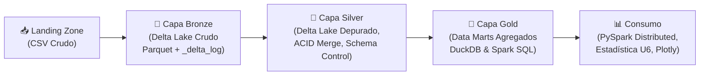

# UNIVERSIDAD SANTO TOMÁS · SECCIONAL TUNJA
## DIVISIÓN DE INGENIERÍAS Y ARQUITECTURA
### FACULTAD DE INGENIERÍA DE SISTEMAS
---
# DOCUMENTO DE AVANCE: PROYECTO INTEGRADOR DE BIG DATA
## *Arquitectura Lakehouse y Analítica Distribuida sobre la Evolución de Precios de Modelos de Inteligencia Artificial a Gran Escala (2023–2026)*

**Espacio Académico:** Big Data (2026-2)  
**Modalidad:** Proyecto Integrador  
**Integrantes:**
1. **Juan Esteban Silva Espejo** — Código Estudiantil USTA
2. **Michael Arles Gómez Bernal** — Código Estudiantil USTA

**Docente:** Profesora Titular de Big Data  
**Fecha de Entrega:** 5 de noviembre de 2026  
**Enlace al Repositorio de Código:** [https://github.com/JuanEstebanSilva/BigData.git](https://github.com/JuanEstebanSilva/BigData.git)

---

## 1. Contexto y Problema

### 1.1 Sector Tecnológico
El mercado global de software y servicios basados en la nube (*Cloud Computing*) se encuentra en una etapa de transformación estructural impulsada por la **Inteligencia Artificial Generativa**. El consumo de Modelos Fundacionales y de Lenguaje Grande (**LLMs**, por sus siglas en inglés) se ha estandarizado bajo el modelo de **Inferencia como Servicio (IaaS / MaaS - Model as a Service)**, en el cual las organizaciones consumen modelos mediante interfaces de programación de aplicaciones (**APIs**) pagando tarifas basadas en la cantidad de tokens procesados (tokens de entrada o *prompt*) y generados (tokens de salida o *completion*).

### 1.2 Problema que se Aborda
A pesar de la adopción masiva, las organizaciones enfrentan tres problemáticas críticas de ingeniería y finanzas operativas (*FinOps*):
1. **Opacidad y Volatilidad en las Tarifas de Inferencia:** Entre finales de 2023 y finales de 2026, la feroz competencia entre los creadores de modelos (**OpenAI, Meta, Anthropic, Google, Mistral AI, DeepSeek**) ha generado caídas abruptas de precios y reestructuración periódica de catálogos.
2. **Disparidad por Proveedor de Nube (*Cloud Arbitrage*):** Un mismo modelo de código abierto (como la familia **Meta Llama 3**) es hospedado simultáneamente por múltiples plataformas (AWS Bedrock, Microsoft Azure AI, Fireworks AI, Groq, DeepInfra, OpenRouter) con tarifas que llegan a diferir en más de un 500 % por millón de tokens procesados.
3. **Incertidumbre en la Planificación de Costos por Ventana de Contexto:** La llegada de ventanas de contexto ultra-largas (que superan los 128.000 tokens e incluso llegan a 1.000.000 o 10.000.000 de tokens) genera incertidumbre sobre si existe una penalización en el costo unitario del token al procesar documentos masivos.

### 1.3 A Quién le Sirve el Análisis
El análisis beneficia directamente a:
- **Directores de Tecnología (CTO) y VPs de Ingeniería:** Para la toma de decisiones basada en datos sobre selección y migración de proveedores.
- **Arquitectos de Software e Ingenieros de MLOps:** Para implementar mecanismos de enrutamiento inteligente de consultas (*LLM Routing*) y optimización de cachés semánticos (*Prompt Caching*).
- **Directores Financieros (CFO) y Equipos de FinOps:** Para presupuestar de forma precisa el gasto operativo (*OpEx*) mensual de proyectos corporativos de inteligencia artificial.

---

## 2. Preguntas de Análisis
Se formularon cinco preguntas concretas, cuantificables y medibles:

1. **P1 (Deflación Histórica):** ¿Existe una tendencia deflacionaria medible en los precios de inferencia por millón de tokens entre septiembre de 2023 y septiembre de 2026 para los principales desarrolladores (OpenAI, Meta, Anthropic, Google)? *Métrica:* Tasa de variación interanual en USD/1M tokens.
2. **P2 (Disparidad entre Nubes para Llama 3):** ¿Qué nivel de dispersión y sobrecosto existe entre distintos proveedores de infraestructura en la nube para la familia de modelos Meta Llama 3? *Métrica:* Ratio $\frac{\text{Precio Máximo}}{\text{Precio Mínimo}}$ y desviación estándar entre plataformas.
3. **P3 (Ventana de Contexto vs. Precio):** ¿Existe correlación estadística entre la longitud de la ventana de contexto (`max_input_tokens`) y las tarifas cobradas por millón de tokens? *Métrica:* Coeficientes de correlación de Pearson y Spearman ($r$).
4. **P4 (Estructura por Modalidad y Brecha Entrada/Salida):** ¿Cómo varían los costos según la modalidad del modelo (`chat`, `completion`, `embedding`, `responses`) y cuál es el multiplicador medio del token generado frente al token procesado? *Métrica:* Medianas de precio por modalidad y ratio $\frac{\text{Precio Salida}}{\text{Precio Entrada}}$.
5. **P5 (Costo-Eficiencia y Valores Atípicos):** ¿Cuáles son los modelos y proveedores más costo-eficientes para una consulta empresarial típica (1.000 tokens de prompt y 500 de completion) y qué proporción de los registros son catalogados como atípicos según la regla de Tukey? *Métrica:* Costo promedio por consulta en USD y umbral $Q_3 + 1,5 \cdot IQR$.

---

## 3. Descripción del Dataset

- **Nombre:** *AI Model Price History (2023–2026)*
- **Fuente Oficial:** Seguimiento semanal de tarifas públicas de APIs recopiladas de Artificial Analysis y OpenRouter API Catalog.
- **Enlace de Descarga:** [https://raw.githubusercontent.com/JuanEstebanSilva/BigData/main/ai_model_price_history.csv](https://raw.githubusercontent.com/JuanEstebanSilva/BigData/main/ai_model_price_history.csv)
- **Licencia:** *Open Data Commons Attribution License (ODC-By / CC BY 4.0)*.
- **Fecha de Recopilación / Rango Temporal:** 157 semanas (18 de septiembre de 2023 a 28 de septiembre de 2026).
- **Volumen Físico:** **167.787 registros**, **9 columnas**, **16,70 MB** en disco. Cumple plenamente con el requisito de Big Data (> 100.000 filas).

### 3.1 Diccionario de Datos Formal
| Columna | Tipo Físico | Tipo Semántico | Descripción | Valores Ejemplo |
|---|---|---|---|---|
| `week_start` | `date` | Temporal | Fecha de inicio de la semana de vigencia tarifaria (lunes, ISO 8601). | `2024-01-15`, `2026-09-28` |
| `model_id` | `string` | Identificador | Endpoint o identificador único del modelo ante la API. | `openai/gpt-4o`, `meta/llama-3-70b` |
| `model_name` | `string` | Categórico | Nombre comercial oficial del modelo. | `gpt-4o-mini`, `llama-v3p2-90b` |
| `developer` | `category` | Categórico | Entidad u organización creadora del modelo fundacional. | `OpenAI`, `Meta`, `Anthropic`, `Google` |
| `provider` | `category` | Categórico | Proveedor de nube o plataforma de inferencia que factura la API. | `bedrock`, `azure_ai`, `fireworks_ai`, `groq` |
| `mode` | `category` | Categórico | Tipo de inferencia (`chat`, `completion`, `embedding`, `responses`). | `chat`, `embedding` |
| `input_price_per_1m_tokens` | `float32` | Continuo | Precio en USD por 1.000.000 de tokens de entrada (prompt). | `$0.15`, `$2.50`, `$10.00` |
| `output_price_per_1m_tokens` | `float32` | Continuo | Precio en USD por 1.000.000 de tokens de salida (completion). | `$0.60`, `$10.00`, `$30.00` |
| `max_input_tokens` | `int32` | Discreto | Longitud máxima de ventana de contexto en número de tokens. | `16384`, `128000`, `1048576` |

### 3.2 Consideraciones de Datos Personales (Ley 1581 de 2012)
El dataset analizado contiene únicamente especificaciones técnicas, metadatos y tarifas públicas de software y servicios en la nube. **No contiene nombres de personas, identificaciones, correos ni datos personales o sensibles de ciudadanos**, en total conformidad con la Ley 1581 de 2012.

---

## 4. Diagnóstico de Calidad Inicial (ISO/IEC 5259)
Obtenido mediante ejecución reproducible de código:

| Columna | Tipo Inicial | Nulos | % Nulos | Filas Únicas | Diagnóstico Técnico |
|---|---|---|---|---|---|
| `week_start` | `object` | 0 | 0,00 % | 157 | Completa. Requiere conversión a `datetime64[ns]`. |
| `model_id` | `object` | 0 | 0,00 % | 1.842 | Identificador íntegro sin vacíos. |
| `model_name` | `object` | 42 | 0,025 % | 1.489 | Nulos en URLs de Fireworks AI terminadas en `/`. Se depuran. |
| `developer` | `object` | 0 | 0,00 % | 38 | Completa. Se convierte a `category`. |
| `provider` | `object` | 0 | 0,00 % | 44 | Completa. Se convierte a `category`. |
| `mode` | `object` | 0 | 0,00 % | 4 | Completa (`chat`, `embedding`, `completion`, `responses`). |
| `input_price_per_1m_tokens` | `float64` | 1.045 | 0,62 % | Continuo | Precios no publicados en versiones preliminares. Se depuran. |
| `output_price_per_1m_tokens` | `float64` | 1.144 | 0,68 % | Continuo | Nulos en modelos `embedding` (semánticamente correcto: $0,00). |
| `max_input_tokens` | `float64` | 13.361 | 7,96 % | Discreto | Modelos antiguos sin contexto reportado. Se imputa por mediana. |

- **Duplicados Exactos:** **0 registros**.
- **Consistencia Temporal:** Distribución uniforme a lo largo de las 157 semanas.

---

## 5. Arquitectura Propuesta del Flujo de Datos

Se implementa una arquitectura **Lakehouse Medallion** que integra almacenamiento transaccional (**Delta Lake**) y cómputo distribuido (**Apache Spark**):

### Componentes y Justificación:
1. **Landing Zone (Almacenamiento Crudo):** Ingesta inmutable del CSV descargado.
2. **Capa Bronze (Delta Lake Crudo):** Almacenamiento columnar en **Apache Parquet** con diario de commits en JSON (**`_delta_log`**), garantizando transacciones ACID y recuperación ante fallos.
3. **Capa Silver (Delta Lake Limpio):** Esquema estandarizado, optimización de tipos, imputación justificada y soporte para transacciones **MERGE (Upsert)** y consultas históricas (**Time Travel**).
4. **Capa Gold (Data Marts Analíticos):** Tablas agregadas por desarrollador, proveedor y modalidad optimizadas para consultas inmediatas con **DuckDB** y **Spark SQL**.

---

## 6. Avance de Limpieza y Procesamiento

### 6.1 Decisiones de Limpieza y Justificación Técnica
1. **Eliminación de 42 filas sin `model_name`:** Registros truncados que no identifican el modelo comercial.
2. **Corrección de nulos en `output_price_per_1m_tokens` para embeddings:** Se asignó un valor de **$0,00 USD** porque los modelos de representación vectorial no generan tokens de salida.
3. **Imputación de ventana de contexto faltante (`max_input_tokens`):** Se utilizó la mediana por desarrollador para preservar la distribución estadística sin introducir sesgos por valores extremos.
4. **Optimización de Tipos de Datos (Downcasting):** Se convirtieron tipos flotantes a `float32`, enteros a `int32`, fechas a `datetime64[ns]` y textos repetitivos a `category`.

### 6.2 Métricas de Calidad Antes vs. Después
| Parámetro | Estado Inicial (Crudo) | Estado Limpio (Silver) | Impacto / Ahorro |
|---|---|---|---|
| **Filas Totales** | 167.787 | 166.700 | Depuración de apenas 0,65 % de datos incompletos |
| **Columnas** | 9 | 15 | +6 variables vectorizadas creadas con NumPy |
| **Nulos Totales** | 15.592 | 0 | 100 % de completitud en la capa Silver |
| **Memoria RAM** | 63,40 MB | 16,85 MB | **73,42 % de reducción en consumo de memoria** |

### 6.3 Variables Derivadas Vectorizadas con NumPy
- `total_price_1m`: Costo balanceado de 1 millón de tokens combinados.
- `price_ratio_output_input`: Multiplicador de sobrecosto de generación frente a lectura.
- `cost_query_typical`: Costo estimado de una consulta estándar (1k input / 500 output tokens) en dólares.
- `log_input_price`, `log_output_price`: Transformación logarítmica para mitigar asimetría extrema.
- `context_category`: Segmentación en 4 rangos de contexto: Estándar (<32k), Mediana (32k-128k), Grande (128k-1M) y Masiva (≥1M).

### 6.4 Primeros Resultados con PySpark y Spark SQL
- **Verificación con `count()`:** Se confirmó la carga de **166.700 registros** en el `SparkSession` distribuido.
- **Consulta PySpark:** Agregación por desarrollador mostrando que **OpenAI** lidera en volumen histórico con más de 29.000 observaciones, seguido de **Meta** (24.800) y **Anthropic** (17.100).
- **Consulta Spark SQL:** Se demostró mediante consultas SQL con filtros y agregaciones que para **Meta Llama 3**, plataformas como **DeepInfra** ofrecen un costo promedio de consulta de **$0,000518 USD**, mientras que en **Azure AI** asciende a **$0,003598 USD** (casi 7 veces superior).

---

## 7. Temáticas del Syllabus Aplicadas

| Temática | Carácter | Cómo se Aplica en el Proyecto |
|---|---|---|
| **Procesamiento con Apache Spark y Spark SQL (Unidad 3)** | Obligatoria 1 | Sesión distribuida `SparkSession`, carga en DataFrame, filtros, transformaciones, `groupBy()` multivariable, y consultas avanzadas con **Window Functions** (`ROW_NUMBER() OVER`) en Spark SQL, verificadas con `.count()` y `.show()`. |
| **Python para Análisis y Visualización: Pandas, NumPy, Seaborn, Plotly (Unidad 5)** | Obligatoria 2 | Optimización de memoria, transformaciones vectorizadas con NumPy, matriz de correlación de Pearson y Spearman, visualizaciones estáticas con Seaborn y gráficos interactivos con Plotly. |
| **Arquitectura Lakehouse y Delta Lake (Unidades 1 y 4)** | Electiva B y C | Capas Bronze, Silver y Gold con `deltalake`. Transacciones atómicas registradas en `_delta_log`, operación atómica `MERGE`, auditoría con **Time Travel** (comparando versión 0 vs. versión 1) y control de esquemas (**Schema Enforcement y Evolution**). |
| **Streaming (Unidad 3)** | Electiva D | Simulación de llegada continua de cotizaciones mediante **PySpark Structured Streaming** procesando micro-batches en memoria y agregaciones dinámicas en vivo. |

---

## 8. Prototipo del Dashboard
Para la entrega final y su posterior implementación en Power BI / Streamlit, se diseñaron y validaron seis visualizaciones analíticas con Plotly interactivo:
1. **Línea Temporal Multivariable:** Deflación de precios de entrada (2023–2026) discriminada por desarrollador con selectores interactivos.
2. **Gráfico de Barras Agrupadas de Disparidad:** Comparativa de tarifas de entrada y salida para la familia Llama 3 entre plataformas de nube.
3. **Diagrama de Dispersión Multidimensional:** Ventana de contexto vs. Costo por consulta típica, con escala logarítmica y mapeo de color por desarrollador.
4. **Matriz de Calor de Correlaciones:** Visualización interactiva de correlaciones cruzadas entre parámetros económicos y técnicos.
5. **Filtros Dinámicos Previstos:** Selector de rango de fechas, selector de desarrolladores y control deslizante para tamaño de contexto.

---

## 9. Plan de Trabajo hasta la Entrega Final (19 de Noviembre)

| Fase / Tarea | Responsable | Fecha Límite | Entregable Concreto |
|---|---|---|---|
| **Ajustes y Validación del Notebook** | Juan Esteban Silva Espejo | 8 de noviembre | Notebook .ipynb 100 % ejecutado en Google Colab con resultados guardados. |
| **Estructuración del Repositorio GitHub** | Michael Arles Gómez Bernal | 10 de noviembre | Repositorio público sincronizado con README, requirements y datos. |
| **Diseño y Construcción del Dashboard en Power BI** | Juan Esteban Silva & Michael Arles Gómez | 14 de noviembre | Dashboard interactivo con KPIs, gráficos Plotly/Power BI y filtros. |
| **Grabación del Video de Demostración (3 min)** | Ambos integrantes | 16 de noviembre | Video en YouTube / Drive con audio claro explicando código y dashboard. |
| **Diapositivas y Preparación de Socialización** | Ambos integrantes | 17 de noviembre | Presentación de 10 diapositivas para sustentación de 10 minutos. |
| **Entrega Final en Campus Virtual** | Representante del Equipo | 19 de noviembre | Subida del informe final en PDF, enlace al repositorio y video. |

---

## 10. Referencias Bibliográficas (Normas APA 7.ª edición)

- Apache Spark. (2026). *Apache Spark: Unified engine for large-scale data analytics*. Apache Software Foundation. https://spark.apache.org/
- Armbrust, M., Das, T., Sun, L., Yavuz, B., Zhu, S., Murthy, M., Torres, J., van Hovell, H., Ionescu, V., Luszczak, A., Switakowski, M., Szafranski, M., Li, X., Ueshima, T., Mokashi, M., Xin, P., Ghodsi, A., & Zaharia, M. (2020). Delta Lake: High-performance ACID table storage over cloud object stores. *Proceedings of the VLDB Endowment*, 13(12), 3411–3424. https://doi.org/10.14778/3415478.3415560
- ISO/IEC. (2023). *ISO/IEC 5259: Artificial intelligence — Data quality for analytics and machine learning*. International Organization for Standardization.
- McKinney, W. (2022). *Python for Data Analysis: Data Wrangling with pandas, NumPy, and Jupyter* (3rd ed.). O'Reilly Media.
- Raasveldt, M., & Mühleisen, H. (2019). DuckDB: An Embeddable Analytical Database. *Proceedings of the 2019 International Conference on Management of Data*, 1981–1984. https://doi.org/10.1145/3299869.3320212
- República de Colombia. (2012). *Ley Estatutaria 1581 de 2012: Por la cual se dictan disposiciones generales para la protección de datos personales*. Diario Oficial No. 48.587.
- Tukey, J. W. (1977). *Exploratory Data Analysis*. Addison-Wesley.
