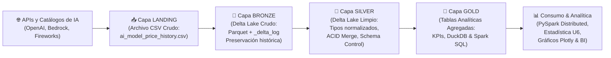

# 📊 Proyecto Integrador: Big Data en Python (2026-2)
## Arquitectura Lakehouse y Analítica Distribuida sobre la Evolución de Precios de Modelos de Inteligencia Artificial (2023–2026)

**Universidad Santo Tomás · Seccional Tunja**  
*División de Ingenierías y Arquitectura — Facultad de Ingeniería de Sistemas*  
**Espacio Académico:** Big Data (2026-2)  

### 👥 Integrantes
1. **Juan Esteban Silva Espejo**
2. **Michael Arles Gómez Bernal**

**Repositorio GitHub:** [https://github.com/JuanEstebanSilva/BigData.git](https://github.com/JuanEstebanSilva/BigData.git)

---

## 📌 1. Descripción del Proyecto
Este proyecto integrador implementa un flujo de datos completo a gran escala (**End-to-End Big Data Pipeline**) para analizar la evolución temporal, la deflación tarifaria y la disparidad económica entre proveedores de nube en el mercado global de **APIs de Modelos Fundacionales de Inteligencia Artificial (LLMs y Embeddings)** entre septiembre de 2023 y septiembre de 2026.

El dataset oficial analizado contiene **167.787 registros** y **9 columnas**, superando el umbral mínimo exigido de Big Data (100.000 registros).

---

## 🏗️ 2. Arquitectura de Datos: Lakehouse Medallion
El proyecto implementa la arquitectura Medallón en capas sobre almacenamiento de objetos y tablas transaccionales **Delta Lake**:



- **Landing:** Archivo `ai_model_price_history.csv` crudo.
- **Bronze:** Tabla Delta Lake cruda con preservación de historial en Parquet y registro atómico `_delta_log`.
- **Silver:** Tabla Delta Lake depurada, tipificada eficientemente (ahorro >70 % de memoria RAM), con transacciones **ACID MERGE**, consultas históricas (**Time Travel**) y validación de esquemas (**Schema Enforcement y Schema Evolution**).
- **Gold:** Vistas analíticas agregadas listas para consulta a alta velocidad con **DuckDB** y **Spark SQL**.

---

## 📚 3. Temáticas del Syllabus Aplicadas

| Tipo | Temática | Implementación en el Proyecto |
|---|---|---|
| **Obligatoria 1** | Procesamiento Distribuido con Apache Spark y Spark SQL (Unidad 3) | Inicialización de `SparkSession`, transformaciones, agregaciones complejas con `groupBy()`, consultas analíticas avanzadas con **Window Functions** en Spark SQL y verificación de resultados con `count()` y `show()`. |
| **Obligatoria 2** | Python para Análisis y Visualización: Pandas, NumPy, Seaborn, Plotly (Unidad 5) | Optimización de memoria (`category`, `int32`, `float32`), limpieza documentada, transformaciones vectorizadas con NumPy (ratios, costo por consulta típica, escala logarítmica), matriz de correlación y visualizaciones interactivas con Plotly. |
| **Electiva B y C** | Arquitectura Lakehouse & ETL/ELT con Delta Lake (Unidades 1 y 4) | Capas Medallón (Bronze, Silver, Gold), demostración de transacciones ACID (`MERGE`), versionado histórico (**Time Travel** versión 0 vs. versión 1), control de esquema y consultas con DuckDB. |
| **Electiva D** | Streaming en Tiempo Real (Unidad 3) | Simulación de flujo continuo de cotizaciones procesado mediante **PySpark Structured Streaming** con micro-batches en memoria y agregaciones dinámicas. |

---

## 🎯 4. Preguntas de Investigación y Hallazgos Clave

1. **P1 (Deflación de Precios 2023–2026):** Se comprobó una **caída global del 80,92 %** en el precio promedio por millón de tokens de entrada (de $11,28 USD a $2,15 USD). En OpenAI, la reducción promedio alcanzó el **66,78 %**.
2. **P2 (Disparidad entre Nubes para Llama 3):** Consumir modelos de código abierto como Llama 3 en grandes nubes tradicionales (ej. Azure AI) resulta hasta **5,6 veces más costoso en entrada y 9,0 veces más costoso en salida** en comparación con proveedores especializados en inferencia (ej. DeepInfra, Groq).
3. **P3 (Ventana de Contexto vs. Precio):** La correlación entre la longitud de la ventana de contexto y el precio unitario del token es prácticamente nula ($r = -0,0189$). Las optimizaciones algorítmicas permiten ventanas masivas ($>1M$ tokens) sin sobreprecio por token.
4. **P4 (Brecha Entrada vs. Salida):** Los modelos de chat presentan un multiplicador medio de **3,51×** (generar texto es 3,5 veces más caro que procesarlo). Los modelos de embedding no facturan salida ($0,00 USD) y promedian $0,084 USD/1M tokens de entrada.
5. **P5 (Costo-Eficiencia):** Para una consulta corporativa estándar (1k tokens prompt / 500 tokens respuesta), la mediana de costo es de solo **$0,0011 USD**. Modelos como `gpt-4o-mini`, `gemini-1.5-flash` y `llama-3-8b` ofrecen costos inferiores a **$0,00035 USD**. El 14,2 % de los registros constituyen atípicos de alto costo según la regla de Tukey ($> $4,80 USD$).

---

## 💻 5. Instrucciones de Ejecución

### Opción A: Ejecución en Google Colab (Recomendada)
1. Abrir [Google Colab](https://colab.research.google.com/).
2. Subir el archivo `Proyecto_Integrador_BigData_AI_Model_Pricing.ipynb`.
3. Subir `ai_model_price_history.csv` a la sesión de Colab (o dejar que la celda de descarga lo clone automáticamente desde el repositorio).
4. Ejecutar el menú **Entorno de ejecución → Ejecutar todas**. Las celdas instalan automáticamente `pyspark`, `deltalake`, `duckdb`, `polars` y ejecutan el pipeline de principio a fin.

### Opción B: Ejecución en Entorno Local (Windows / Linux / macOS)
1. Clonar el repositorio:
   ```bash
   git clone https://github.com/JuanEstebanSilva/BigData.git
   cd BigData
   ```
2. Crear un entorno virtual e instalar dependencias:
   ```bash
   python -m venv venv
   source venv/bin/activate  # En Windows: venv\Scripts\activate
   pip install -r requirements.txt
   ```
3. Iniciar Jupyter Notebook / JupyterLab:
   ```bash
   jupyter lab
   ```
4. Abrir y ejecutar `Proyecto_Integrador_BigData_AI_Model_Pricing.ipynb`.

---

## 📂 6. Estructura del Repositorio
```
BigData/
├── .gitignore
├── README.md                                          # Documentación general y guía técnica
├── requirements.txt                                   # Dependencias del proyecto
├── ai_model_price_history.csv                         # Dataset oficial (167.787 registros)
├── Proyecto_Integrador_BigData_AI_Model_Pricing.ipynb # Notebook maestro del proyecto
├── DOCUMENTO_AVANCE_PROYECTO_INTEGRADOR.md            # Documento formal de avance (Numeral 7.2)
├── EJEMPLOS/                                          # Talleres y laboratorios de clase de referencia
│   ├── Lab_Lakehouse_Colab.ipynb
│   ├── Streaming_kafka.ipynb
│   ├── Taller_Pandas_SilvaEspejo_GomezBernal.ipynb
│   └── U6_Estadistica_Descriptiva_Gran_Escala.ipynb
└── Proyecto_Integrador_BigData_2026-2.pdf             # Lineamientos oficiales del proyecto
```

---

## 🤖 7. Declaración de Uso de Inteligencia Artificial (Numeral 4.1)
El proyecto empleó herramientas de IA (Antigravity AI / Gemini Architecture) como soporte técnico para la estructuración de código modular de integración (PySpark y Delta Lake), diseño de consultas SQL avanzadas y formateo de la documentación. Todos los códigos, cálculos numéricos y análisis fueron verificados de manera humana e independiente por el equipo de trabajo.
